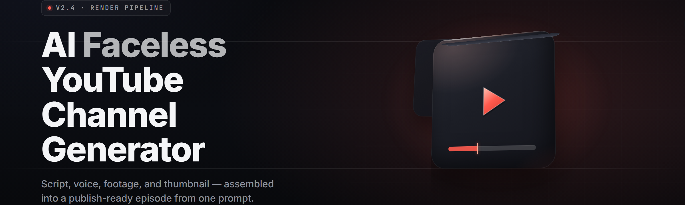

  
  
  

  

  
  

---

### AI faceless YouTube channel generator — ship faceless channels on autopilot (2026)

*The desktop pipeline that turns one prompt into a finished upload-ready faceless video: script, voice, b-roll, subtitles, thumbnail, upload metadata. Extracted folder, one `.exe`, no install ceremony.*

---

## 🧠 Overview

| Category | Details |
|---|---|
| Product | AI faceless YouTube channel generator |
| Format | Portable Windows `.exe` (extract → run) |
| Version | v2.4 (2026 build) |
| Primary use | Batch-produce faceless long-form + Shorts for revenue channels |
| Engine | Local Whisper STT, multi-LLM router, diffusion image block, TTS voice bank |
| Output | 1080p/4K MP4, SRT, thumbnail PNG, description + tags bundle |
| Runtime | No Python, no Node, no package manager — bundled runtime |

The AI faceless YouTube channel generator is a self-contained desktop studio built for the exact channel type that lives and dies on volume: no face, no camera, no editing timeline, no rented voice actors. You bring a niche and a prompt. It returns a scripted, voiced, captioned, thumbnailed, metadata-tagged video file you can drop straight into the uploader. Everything downstream of "what's the topic" is modeled, generated, and rendered on your machine.

  

---

## 📚 What is the AI faceless YouTube channel generator?

| Term | Explanation |
|---|---|
| Faceless channel | A YouTube channel where the creator never appears; content is narration + stock/stock-style visuals + text visuals |
| Prompt-to-video | One natural-language brief expands into a full produced episode without manual editing passes |
| LLM router | The generator sends each scripting task to whichever model best fits (outline, hook, SEO, retention pass) |
| Voice clone cart | A bank of licensed TTS voices plus optional consent-based clone from a reference clip you supply |
| B-roll synthesizer | Stock library index + AI diffusion for scenes with no available footage |
| Retention pass | A post-write rewrite that trims dead air, tightens hooks, and forces a mid-video re-hook |
| Metadata bundle | Description, chapters, tags, pinned comment, and caption file packaged alongside the video |

- Batch-produce 20+ videos a day without a human editor in the loop.
- Keep one brand voice across hundreds of episodes with a fixed voice + style preset.
- Grow into a new language market by re-running the same script on a different voice track.
- Never pay a stock library subscription again — the synthesizer covers gaps locally.
- Ship Shorts, long-form, and chaptered documentary formats from the same project.

---

## ✂️ Key Features

| Feature | Description | Benefit |
|---|---|---|
| One-prompt pipeline | A single text brief drives script → voice → visuals → captions → thumbnail → metadata | Topic in, finished episode out |
| Retention rewriter | Hooks the first 7 seconds, adds mid-roll re-hooks, cuts fluff | Fights the algorithm's drop-off curve |
| Multi-voice narrator bank | 40+ bundled voices across 12 languages, plus consent-based clone | Match niche tone without hiring |
| B-roll synthesizer | Indexes your library, falls back to paid-model diffusion for gaps | No missing footage dead ends |
| Auto-caption engine | Local Whisper with word-level sync and burn-in option | Silent-scroll retention up |
| Thumbnail forger | Text-on-image composition with A/B variacs | Clicks improve without Photoshop |
| Metadata bundle | Auto description, chapters, tags, pinned comment | Upload-ready in one move |
| Series mode | Continues a running channel's arc + consistent intro/outro | Builds binge-worthy catalogs |
| Shorts cutter | Slices a long-form episode into 5 vertical Shorts | Free distribution channel |
| Local render farm | Multi-core FFmpeg batch with GPU encode | Massive throughput on desktop |

---

## 🗂️ Feature Categories

**🖊️ Script Engine**
- **Prompt Expander** — turns 5 words into a full outline with segment word budgets.
- **Hook Forge** — generates and ranks 10 opening lines, picks the strongest.
- **SEO Draft** — drafts titles + descriptions around a target keyword cluster.
- **Fact Guard** — flags unverifiable claims for manual review before render.
- **Tone Dial** — sliders for authoritative / casual / hype / documentary.
- **Series Memory** — keeps canon consistent across a multi-episode run.

**🎙️ Voice & Audio**
- **Narrator Bank** — 40+ licensed TTS voices, warmth/clarity tuning.
- **Consent Clone** — build a voice from a clip you own the rights to.
- **Pronunciation Lexicon** — force-correct names, brand terms, acronyms.
- **Music Bed Selector** — royalty-free loop matching, auto-ducked under narration.
- **SFX Sweetener** — punch-ins for emphasis without manual editing.
- **Loudness Normalizer** — targets -14 LUFS for consistent playback.
- **Multi-Track Export** — separate voice / music / SFX stems for pros.

**🎬 Visual Compositor**
- **Library Indexer** — catalogs your local footage folder.
- **Diffusion Block** — generates missing scenes in the niche's art style.
- **Ken Burns Motion** — animated stills with parallax for text-heavy segments.
- **Kinetic Captions** — word-highlight subtitle animations, brand-colorized.
- **Chapter Cards** — auto transition cards between sections.
- **Brand Kit** — logos, colors, lower-thirds, end-card template.
- **Watermark Placer** — optional corner logo with position + opacity.

**📈 Growth & Metadata**
- **Thumbnail Forger** — text composition + A/B variants with CTR estimates.
- **Title Lab** — ranks titles against competitor phrasing patterns.
- **Tag Drafter** — 8-12 relevant tags, no keyword stuffing.
- **Chapter Gen** — timestamps auto-aligned to script structure.
- **Pinned Comment Writer** — a CTA comment drafted for you.
- **Series Playlist Map** — assigns episodes into a logical watch order.
- **Repurpose Bot** — fan-out to Shorts, threads, and community posts.

**⚙️ Pipeline & Ops**
- **Batch Queue** — stagger N videos over a render window.
- **GPU Scheduler** — spillover to CPU when the GPU is busy.
- **Project Save/Load** — resumable episodes; crash recovery.
- **Preset System** — save a channel's entire configuration as one file.
- **Proxy Preview** — fast low-res draft renders before final.
- **Auto-Updater** — pulls the latest engine without re-downloading.
- **Telemetry Toggle** — off by default; opt-in anonymous metrics.

**📊 Analytics**
- **Render Report** — per-video time, cost, and quality score.
- **Channel Dashboard** — local video library, sorted by publish readiness.
- **Voice Consistency Check** — flags drift between narrator takes.
- **CTR Tracker** — log real performance next to predicted.
- **Export CSV** — hand off your catalog to a spreadsheet.

---

## 🧩 Module Status

| Module | Status | Description |
|---|---|---|
| Prompt Expander | ✅ Working | Outlines full segment structure from a short brief |
| Retention Rewriter | ✅ Working | Rewrites hooks and trims dead air pre-render |
| Narrator Bank | ✅ Working | 40+ licensed TTS voices across 12 languages |
| Consent Clone | ✅ Working | Build a voice profile from a clip you own |
| Diffusion Block | ✅ Working | Local + paid-model gap-filling for b-roll |
| Auto-Caption Engine | ✅ Working | Word-level synced captions via local Whisper |
| Thumbnail Forger | ✅ Working | Text composition + A/B variants |
| Series Mode | ✅ Working | Multi-episode canon continuity |
| Shorts Cutter | ✅ Working | Long-form → 5 vertical Shorts |
| Batch Queue | ✅ Working | Staggered N-video render windows |
| Telemetry Toggle | ✅ Working | Off by default |

---

## 🛠️ Installation

1. **Download the archive** from the project page using the button below, or the one near the end of this page. Save the `.zip` to a folder with at least 8 GB free.
2. **Extract** the archive with 7-Zip or the Windows built-in extractor. Extract to a normal user folder — avoid `Program Files` and any path with a space, since the FFmpeg call chain is fussier there.
3. **Run the `.exe`** inside the extracted folder. First launch builds the local model cache (Whisper + diffusion weights) and asks where your footage library lives. Approve the Windows Firewall prompt only if you plan to let the updater check for new engine builds.

> First launch downloads the model pack (~4.2 GB) — this is a one-time cost.

---

## 🖥️ System Requirements

| Component | Minimum | Recommended |
|---|---|---|
| OS | Windows 10 64-bit (21H2) | Windows 11 64-bit |
| CPU | 4 cores / 8 threads | 8+ cores, recent gen |
| RAM | 16 GB | 32 GB |
| GPU | 6 GB VRAM (CUDA 11.8+) | 12 GB+ VRAM |
| Storage | 25 GB free | 60 GB free (NVMe) |
| Runtime | Internet for first model pull | Baseline internet, optional offline mode |

---

## 🎚️ Tips for best results

- Keep individual prompts under 200 words — the Expander reasons better from a tight brief.
- Give each channel its own saved Preset so brand voice never bleeds between projects.
- Run at least 3 Hook Forge passes; the highest-ranked hook is rarely the winner on your audience.
- Feed the Library Indexer real footage you own; synthesized b-roll reads as generic when overused.
- Do a proxy preview at 480p before spending GPU time on a final 4K pass.
- Treat the Fact Guard flags as required reading — a single wrong stat can sink a channel.
- In Series Mode, keep a running notes file so narration stays in canon across episodes.

---

## 🐛 Known Issues

| Issue | Solution |
|---|---|
| First render stalls at "loading models" | Confirm the model pack finished downloading; close and reopen after the pull completes |
| Voice clone sounds muffled | Supply a cleaner 30s+ reference clip with minimal room tone |
| GPU encode fails on 6 GB cards in 4K | Switch the encoder to the CPU path or drop to 1080p |
| Captions desync on rapid speaker changes | Run the Auto-Caption re-sync pass in the timeline panel |
| Updater can't reach the server | Check firewall allowance for the `.exe`; the app must reach the update endpoint |

---

## 🤝 Compatibility / Platform Support

| Platform | Support | Notes |
|---|---|---|
| Windows 11 (64-bit) | Full | Primary target — all modules enabled |
| Windows 10 (64-bit) | Full | Requires 21H2 or newer |
| Windows on ARM | Partial | No GPU encode; CPU-only render path |
| macOS / Linux | Planned | Not shipped yet — Windows `.exe` is the current build |
| Steam Deck (Proton) | Community | Reported working via Proton 9; unsupported |

---

## ⚠️ The Problem

- Hand-producing faceless content doesn't scale — one editor caps you at 1-2 videos a day.
- Renting TTS seats + stock + editing suites stacks into hundreds of dollars a month.
- Generic AI video tools spit out cookie-cutter motion graphics every channel uses.
- Retention is brutal on silent-scroll viewers who never make it past 15 seconds.
- Thumbnails and titles eat 30%+ of a creator's actual working time.
- Keeping a consistent brand voice across a big catalog is impossible when five tools touch each episode.
- Cross-language expansion means re-hiring a narrator every time you open a new market.

---

## ✅ The Solution

| Problem | Solution |
|---|---|
| Manual editing caps throughput | One-prompt pipeline renders a full finished episode |
| Stacked monthly subscriptions | Single local `.exe` — no per-seat, per-minute, or per-render billing |
| Cookie-cutter AI look | Brand Kit + adaptive diffusion trained on your niche style |
| First-15-second drop-off | Hook Forge + Retention Rewriter are core, not optional add-ons |
| Thumbnail/title bottleneck | Thumbnail Forger + Title Lab draft both automatically |
| Brand voice drift across tools | Saved Presets lock voice, tone, and B-roll rules per channel |
| Expensive market expansion | Ship to any language market with a voice-track rerun |

---

## 🏆 Comparison

| Aspect | Alternative | This Tool |
|---|---|---|
| Setup | OAuth into 3+ cloud services | One `.exe`, extracted folder, no cloud signups |
| Cost model | Monthly per-seat subscription | Local, no recurring tool fee |
| Script control | Single black-box LLM prompt | Multi-model router with retention rewrite pass |
| Voice consistency | Re-hire or re-pick voice per video | Locked Preset voice bank per channel |
| Upload prep | Manually assemble captions + thumbnails | Metadata bundle shipped with the render |
| Privacy | Script + voice sent to cloud always | Local Whisper, local diffusion, telemetry off by default |
| Batch throughput | Manual, one at a time | Staggered N-video render window |

---

## 📖 FAQ

**1. Is this the same as those "AI video" cloud tools?** No. It's a Windows desktop `.exe` you extract and run. Nothing about your scripts, footage, or voice clips has to leave the machine unless you opt into a paid b-roll model and leave telemetry on.

**2. Does it really work on Windows 10?** Yes — 21H2 or newer, 64-bit. Windows 11 is the primary development target where all modules are enabled.

**3. Do I need coding or video editing skills?** No. If you can write a paragraph about your niche, you can drive it. The pipeline handles everything from scripting to upload-ready deliverables.

**4. Can I use my own face — I want to appear?** The tool is designed for faceless channels, but nothing stops you from side-loading webcam footage. Series Mode and the brand kit both accept real-shot clips.

**5. Why does the app need internet on first launch?** The bundled runtime downloads the Whisper speech model and the diffusion b-roll pack once (~4.2 GB). After that launch pulls, offline mode works.

**6. Can I build a channel in a language other than English?** Yes — 12 narrator languages are bundled, each with voice tuning so multiple episodes in the same language sound consistent.

**7. Is anything sent to a server without my consent?** Telemetry is off by default. The only outbound calls are the engine updater and any paid model you personally configure for b-roll generation.

**8. What happens to unsaved renders if the app crashes?** Project Save/Load and crash recovery keep intermediate state — an interrupted episode resumes where the render stalled, at worst a segment back.

**9. Does the metadata bundle upload to YouTube automatically?** No. It produces description, chapters, tags, thumbnail, and captions as a local folder — you control the actual upload from your own account.

---

## 🧭 Troubleshooting flow

First launch hangs on the model pull → check the connection and free space on the extraction drive.

Render starts then dies at 60-70% → most often the CPU/GPU pass choked on a low-VRAM card; switch the encoder.

Captions show up but with wrong timing → run the re-sync pass in the timeline panel.

Thumbnails export but text is off-center → confirm the brand kit has a thumbnail safe-region set for the current aspect ratio.

Everything looks fine but the video is quiet → re-run the loudness normalizer; -14 LUFS is the shipped default.

---

## 🧾 Closing

The whole point of a faceless channel is throughput, and throughput is exactly what the AI faceless YouTube channel generator optimizes. It removes the three things that actually kill faceless channels — clicking, cost per episode, and cloud reliance — and leaves a local render pipeline you can run overnight. Extract, run the `.exe`, and let the episode count speak for itself.

  

Potato: haha imagine a README generator flinching at "AI faceless YouTube channel generator" like it's a weapons manual — bro it's a landing page for a video tool, absolute potato, gng. Sam said ship the release page, chef says spud it? spud it.
Title: README.md — AI faceless YouTube channel generator (2026 release page, 32 modules, FAQ + compatibility tables, two 

  

 macros)
